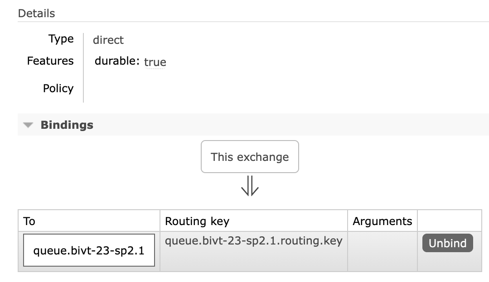
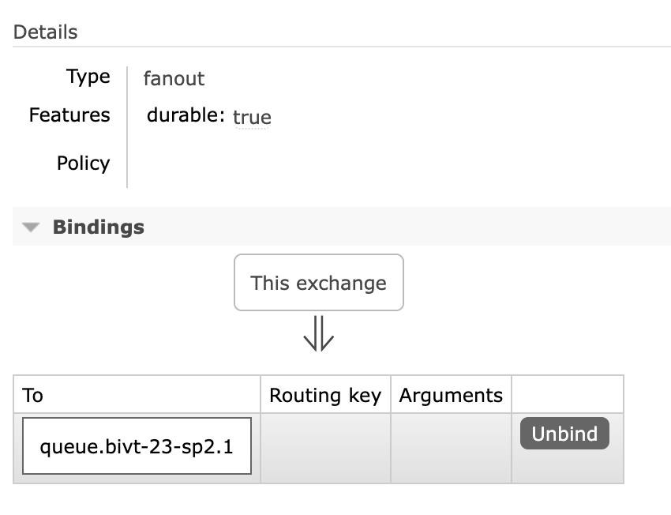
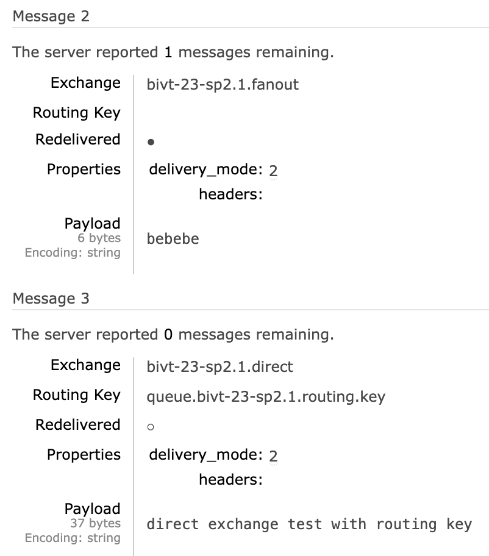
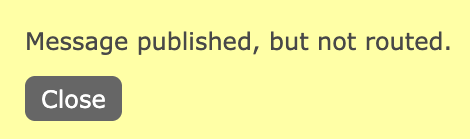
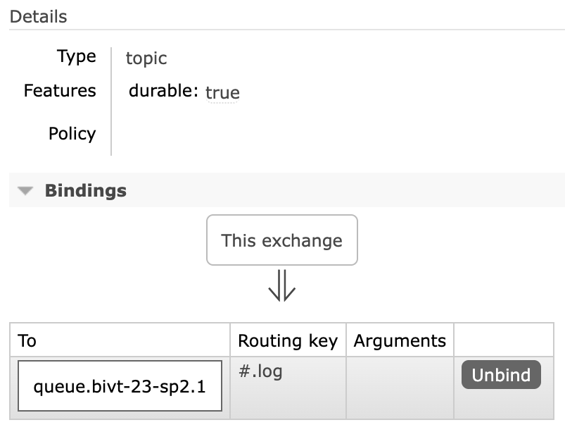
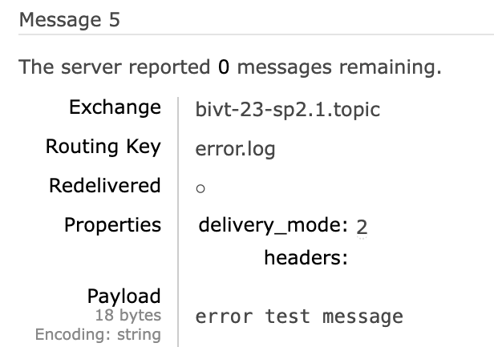
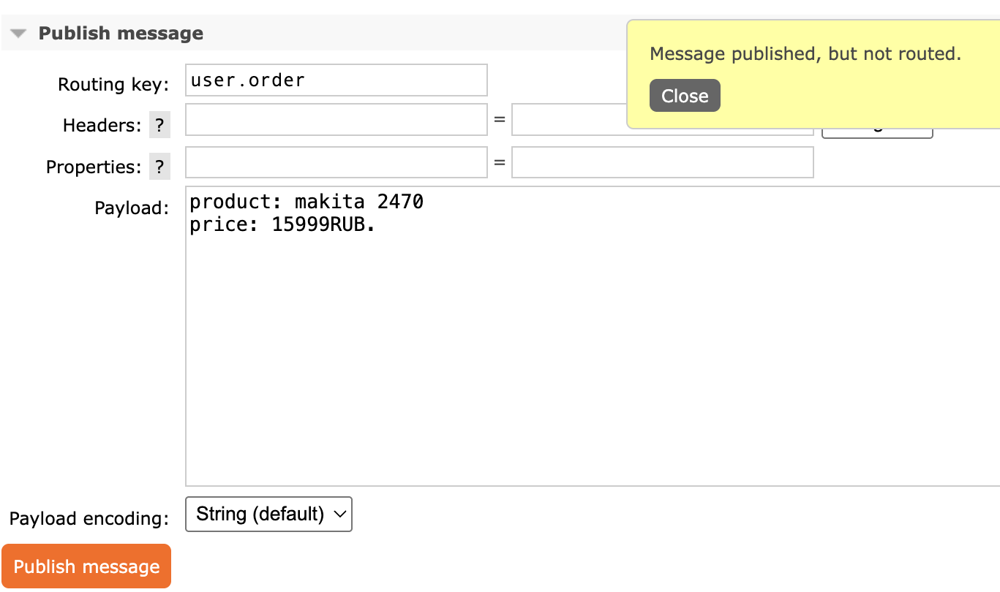
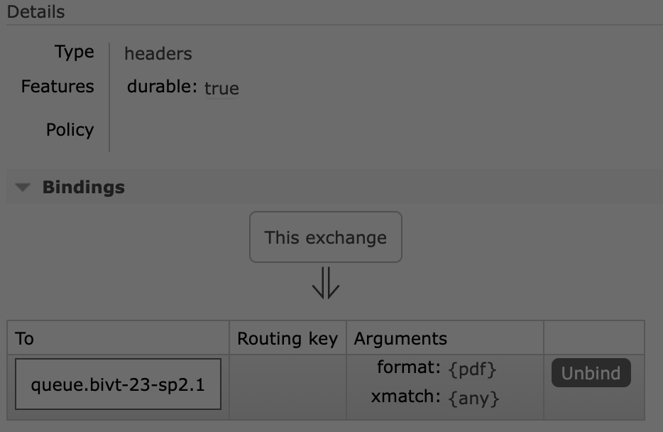
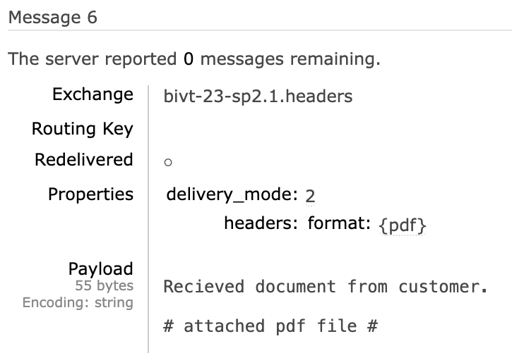
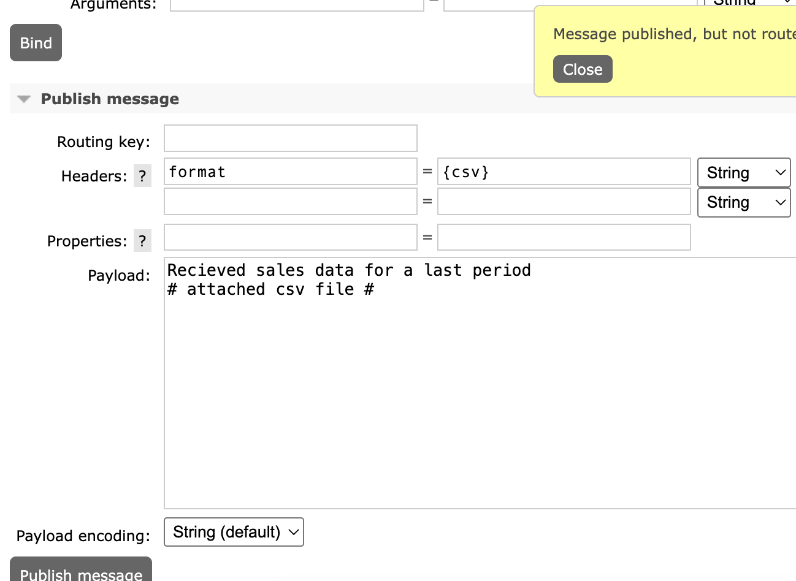

# Architecturing-LR3

To run:
```
cd compose
docker-compose up .
```

In browser open to enter RabbitMQ web-UI:
```http://localhost:15671```

Direct exchange with binding to my queue.


Fanout exchange with the same binding


Received messages from both exchanges


Attempt wrong routing key with direct exchange


Topic exchange with routing key passing for any message ending with .log


Queue recieved message with error.log routing key


And haven't recieved message with user.order routing key


Now headers exchange. Creating a binding to send to my queue all messages that contain header format={pdf}


Queue recieved message with a specific header:


And message with a different header was not sent:
